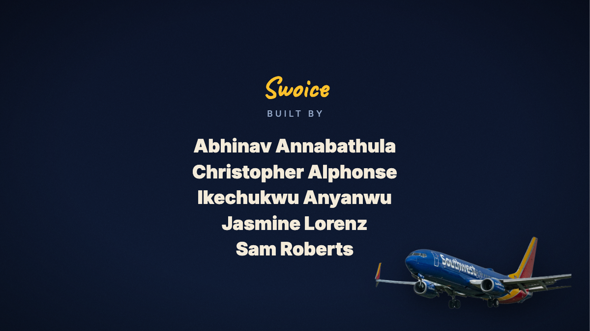

# The Two Clocks

A narrated, animated explainer built with [Remotion](https://www.remotion.dev/). It shows how a spoken radio call from the ramp ("hydraulic") becomes a checked, human-approved update in an airline's system of record, instead of sitting unheard while the system says "on time".

<p align="center">
    
</p>

- 1920x1080 at 24 fps, about 5 minutes 41 seconds (341 s): a 7 s "Runway Rebels presents" intro, 13 narrated scenes (S1 to S16), the screen recording of the demo (`public/demo/video1.mp4`, about 130 s, with its own audio), then three closing scenes (S17 value, S18 rollout, S19 conclusion, about 1 minute). Narration is split into `ACT1` (13 scenes) and act 2 (3 scenes) in `timing.ts`.
- One composition, `TwoClocks` (`src/Root.tsx`).
- Narration is generated with ElevenLabs (voice: Matilda). The music bed and intro sound effect are in the repo, so you only need an ElevenLabs key if you change the narration.

## Setup

Requires Node `^20.19.0 || ^22.13.0 || >=24`.

```console
npm install
```

## Commands

```console
npm run dev       # open Remotion Studio and preview the video
npm run render    # render to out/twoclocks.mp4
npm run build     # bundle the project (remotion bundle)
npm run lint      # eslint + tsc
npm run upgrade   # upgrade Remotion
```

## Project layout

| Path | What it is |
|---|---|
| `src/Root.tsx` | Registers the `TwoClocks` composition |
| `src/TwoClocks/TwoClocks.tsx` | Top-level sequence: intro, 13 scenes, audio |
| `src/TwoClocks/Intro.tsx` | "Runway Rebels presents" intro |
| `src/TwoClocks/scenes1.tsx`, `scenes2.tsx`, `scenes3.tsx` | Scenes S1 to S9, S11 to S16 (S6, S10 and S15 were cut from the script) and the closing scenes S17 to S19 |
| `src/TwoClocks/art.tsx` | Shared drawn pieces (plane, ground, clocks, crew, and so on) |
| `src/TwoClocks/timing.ts` | Narration text, clip lengths, scene lengths and music plan |
| `src/TwoClocks/Music.tsx` | Builds the music bed (intro, loop, ending) to fit the video length |
| `public/twoclocks/n1.wav` to `n16.wav` | Narration, one clip per scene |
| `public/demo/video1.mp4` | Demo screen recording (24 fps H.264/AAC copy of `video1.mov`) |
| `public/music/bed.mp3` | Music bed, 120 BPM |
| `public/sfx/intro.wav` | Intro sound effect |
| `scripts/` | Narration and sound-effect generators (see below) |
| `presentation/` | Video production package and the 3-minute presentation script |
| `src/server/` | Optional image server (see below) |

## Timing

Everything is driven by `src/TwoClocks/timing.ts`. Scene starts and narration land on the music's beat grid (120 BPM, one beat is 0.5 s), and each scene length is derived from its narration clip length. If you change the narration, update `NARR_RAW` (the raw clip lengths in seconds); scene lengths, cuts, and the music loop are computed from it.

- Each narration line starts half a second (1 beat) into its scene and gets at least 0.25 s of silence after it. Scene lengths round up to a whole beat (0.5 s). All drawn animations run `PACE = 1.2` times faster (`src/TwoClocks/art.tsx`).
- Clips play at the recorded speed (`VOICE_RATE = 1`). `NARR_RAW` holds the recorded lengths.
- Demo placement: the demo starts `X_IN` (1 s) before the last act 1 scene ends and plays `DEMO_FRAMES` frames. It is cut at 130.67 s because the recording shows the macOS screenshot toolbar after about 131 s. Act 2 starts `X_OUT` (0.5 s) before the demo ends, so changing `DEMO_FRAMES` moves act 2, the music and the total length automatically.
- To make the demo mp4 from a `.mov` (the source is variable frame rate): `ffmpeg -i video1.mov -vf "fps=24,scale=-2:1080" -c:v libx264 -crf 20 -pix_fmt yuv420p -c:a aac -b:a 160k public/demo/video1.mp4`.
- The music's own ending lands on the last frame: the leftover time (under 4 s) is added to the last scene.

## Regenerate the narration

Needs an ElevenLabs key and macOS (`afconvert` is used to make the WAV files).

1. Put `ELEVENLABS_API_KEY=...` in `.env.local` (see `.env.example`). `.env.local` is gitignored.
2. Run the command that matches the current narration (model `eleven_v3`, tag `[upbeat]`):

```console
npx tsx --env-file=.env.local scripts/generate-narration.mts --model eleven_v3 --tag "[upbeat]"
```

The script's own defaults differ: with no flags it uses `eleven_multilingual_v2` and no tag, so the result will not match the shipped narration.

Options:

| Option | Default | Notes |
|---|---|---|
| `--scenes 1,2,3` | all | Redo only these scenes |
| `--out DIR` | `public/twoclocks` | Output folder |
| `--model ID` | `eleven_multilingual_v2` | `eleven_v3` skips previous/next text stitching |
| `--tag "[upbeat]"` | none | Audio tag, `eleven_v3` and `eleven_v4` only. Older models read it aloud |
| `--stability N` | `0.35` | Voice stability |
| `--style N` | `0.5` | Not supported on `eleven_v4` |
| `--speed N` | `1.1` | Not supported on `eleven_v4` |

The script reads the lines from `TEXT` in `timing.ts` and writes `n1.wav` to `n16.wav` (mono, 44.1 kHz, 16-bit).

After regenerating, measure each new clip and update `NARR_RAW` in `timing.ts`:

```console
afinfo public/twoclocks/n1.wav | grep "estimated duration"
```

## Regenerate the intro sound effect

Needs Python 3 and numpy.

```console
python3 scripts/make-intro-sfx.py
```

It writes `public/sfx/intro.wav`. Brick timings in the script must match `ROWS`, `FALL` and the exit time in `src/TwoClocks/Intro.tsx`.

## Presentation material

- `presentation/educational-video-package.md`: titles, narrative approach, scene plan and a source map for every fact in the video.
- `presentation/presentation-script.md`: the 3-minute "The Ramp Knows" presentation script.

## Image server (from the template)

The project started from the Remotion still-image template, and the server is still included. It renders a composition as a still image on request.

```console
npm run server
```

Then open `http://localhost:8000/TwoClocks.png`. Use the composition ID in the path and a `.png` or `.jpeg` extension. Query strings are passed as input props, for example `?title=Hello+World`. The server needs [Bun](https://bun.sh) (installed as a dev dependency).

Caching is set by `CACHE_MODE` in `src/server/config.ts`:

- `"filesystem"` (default) caches images locally.
- `"none"` renders every request.
- `"s3-bucket"` caches in S3. Set `AWS_BUCKET_NAME` and `AWS_REGION` in `config.ts`, and provide `AWS_ACCESS_KEY_ID` and `AWS_SECRET_ACCESS_KEY` in `.env` (see `.env.example`).

The server has no authentication or access control, so put it behind something before exposing it publicly. A `Dockerfile` is included for deploying it. For serverless stills, see [Remotion Lambda](https://remotion.dev/lambda).

## Docs and help

- [Remotion fundamentals](https://www.remotion.dev/docs/the-fundamentals)
- [Remotion Discord](https://discord.gg/6VzzNDwUwV)
- [Report a Remotion issue](https://github.com/remotion-dev/remotion/issues/new)

## License

Note that for some entities a company license is needed. [Read the terms here](https://github.com/remotion-dev/remotion/blob/main/LICENSE.md).
